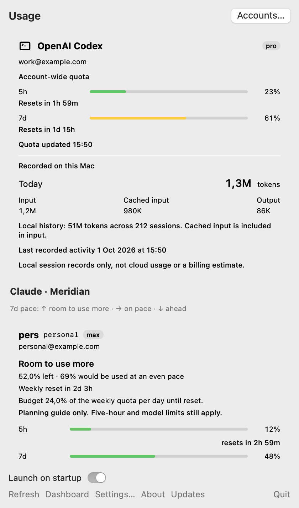

# MeridianBar

A native macOS menu bar app that watches **every Claude account** managed by
[Meridian](https://github.com/rynfar/meridian): quota pressure per account,
always visible, a live answer to "is the proxy even up?", and one place to
sign in, switch, and remove accounts.

<p align="center"></p>
<p align="center"></p>
<p align="center"><sub>Staged data — real accounts never appear in this repo.</sub></p>

Meridian multiplexes several Claude Max accounts behind one local endpoint.
What it doesn't give you is ambient awareness: which account is about to hit
a rate-limit window, which one is exhausted, when the windows reset — and
whether Meridian itself is running. MeridianBar puts all of that in the menu
bar, per account, identified by name.

## Install

```bash
curl -fsSL https://raw.githubusercontent.com/Jean-Reinhold/meridian-bar/main/install.sh | bash
```

That's it — the script fetches the latest release, verifies its sha256,
installs to `/Applications`, and launches the app. Other options:

```bash
# Build and install from source (needs Command Line Tools, no Xcode)
curl -fsSL https://raw.githubusercontent.com/Jean-Reinhold/meridian-bar/main/install.sh | bash -s -- --from-source

# Remove it again
curl -fsSL https://raw.githubusercontent.com/Jean-Reinhold/meridian-bar/main/install.sh | bash -s -- --uninstall

# Or, from a clone
make install
```

> MeridianBar is ad-hoc signed, not Apple-notarized — a deliberate project
> decision (see [`okf/06`](okf/06-release.md)). Integrity comes from the
> published sha256, which the installer verifies. Sparkle in-app updates
> (stable/beta channels) ship in the app, and each release also publishes a
> Homebrew cask to our tap: `brew install --cask jean-reinhold/tap/meridian-bar`
> *(available once the first CI-built release lands)*.

### The `tap/` submodule

[`tap/`](tap) is a git submodule pointing at
[Jean-Reinhold/homebrew-tap](https://github.com/Jean-Reinhold/homebrew-tap),
the Homebrew tap our release workflow bumps on every tag. Homebrew requires
taps to live in a separate repo named `homebrew-tap` — the shorthand
`jean-reinhold/tap/...` hardcodes that lookup — so the cask can't live here
directly (details in [`okf/06`](okf/06-release.md)). The submodule exists for
visibility only: it is **not needed to build or run**, and a plain
`git clone` without `--recurse-submodules` is fine. The pinned commit can lag
the newest release (the workflow pushes to the tap repo directly); refresh it
with `git submodule update --remote tap`.

## What you see

- The bar shows each Claude profile's overall **7d usage percentage** by
  default. It does not substitute Fable usage when weekly data is missing.
  Colors still warn about the worst quota window. The active profile is
  underlined.
  If Meridian is unavailable, its segments become a gray offline marker.
  When the base URL points at a model router, the account that serves Fable
  requests gets an `F<percent>%` suffix with its weekly Fable usage, for
  example `rein 34%→ F67%`, and a FABLE badge on its card.
- Weekly pace arrows compare usage with elapsed time in the seven-day
  window. `↑` means room to use more, `→` means within five percentage
  points of an even pace, and `↓` means ahead of pace. Cached quota
  readings omit the arrow. The dropdown shows remaining quota and a daily
  budget until reset, or an hourly budget in the final day. These are
  planning estimates, not automatic account switching or extra requests.
  Model-specific limits still apply.
- **On click** — per-account Claude cards: every quota window Meridian
  reports (7d, 7d Fable, …), email, plan, active / exhausted / login-needed
  badges, extra-usage credits, and a health footer with Meridian's version
  and data age.
- **Accounts…** — Claude accounts: Meridian profiles and the default CLI
  login. Add an account and sign in from the browser, sign in again, switch,
  sign out, remove. Every change runs the official `meridian` or `claude`
  command.
- **Native and light** — SwiftUI `MenuBarExtra`, no Electron, no webview;
  an `LSUIElement` agent app idling in the tens of MB. Network access is
  your loopback Meridian endpoint. Nothing else.

## Requirements

- macOS 14+ (Liquid Glass look on macOS 26+, graceful material fallback below)
- [Meridian](https://github.com/rynfar/meridian) running locally
  (default `127.0.0.1:3456`, configurable)
- Optional: the `claude` CLI for Claude sign-ins. Without it, account
  sign-in actions report that the tool is missing; nothing crashes.

## Developing

```bash
make build     # swift build -c release
make app       # assemble dist/MeridianBar.app
make run       # build + launch
make test      # unit tests
```

Plain Swift toolchain — Command Line Tools are enough; there is no Xcode
project. The design, verified Meridian API surface, feature plan, and all
decisions of record live in [`okf/`](okf/README.md). Contributions welcome —
see [CONTRIBUTING](CONTRIBUTING.md); questions go to
[Discussions](https://github.com/Jean-Reinhold/meridian-bar/discussions).

## License

MIT — see [LICENSE](LICENSE).
